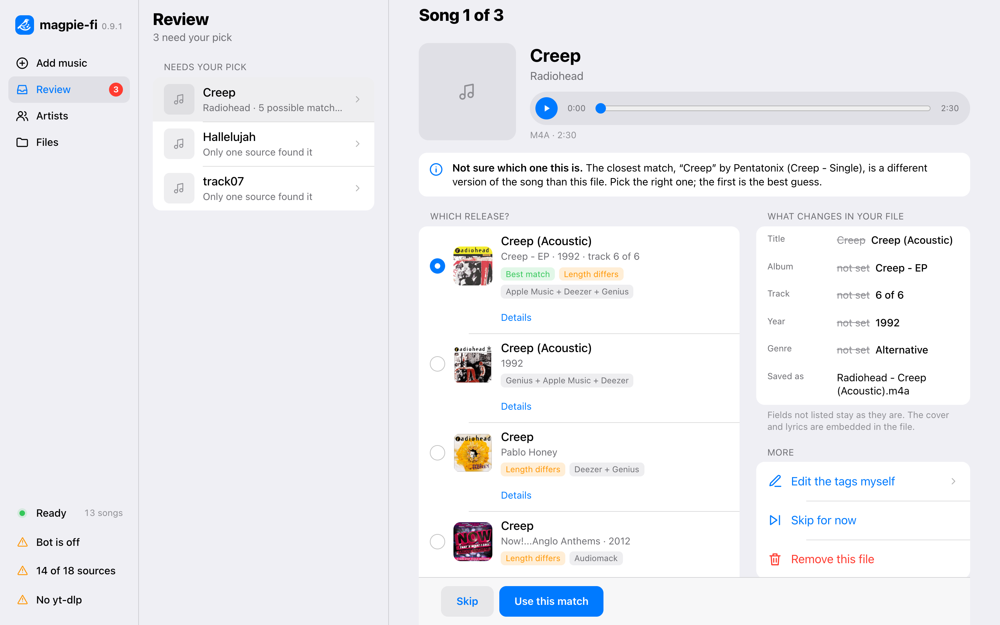
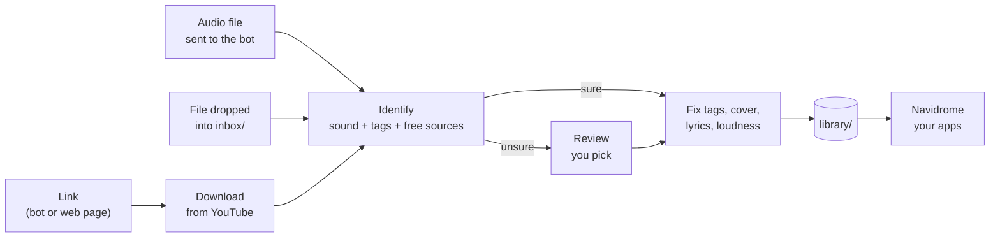
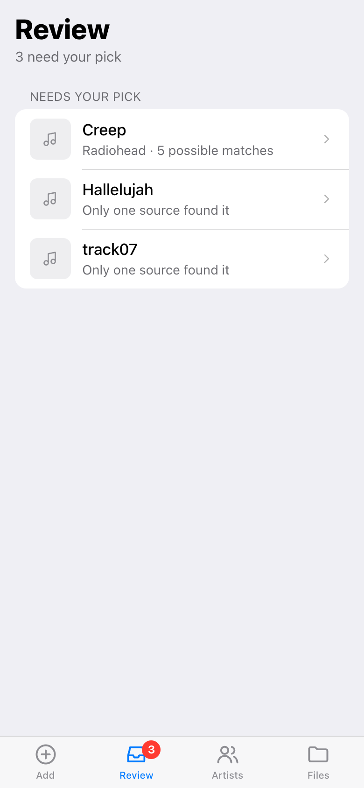
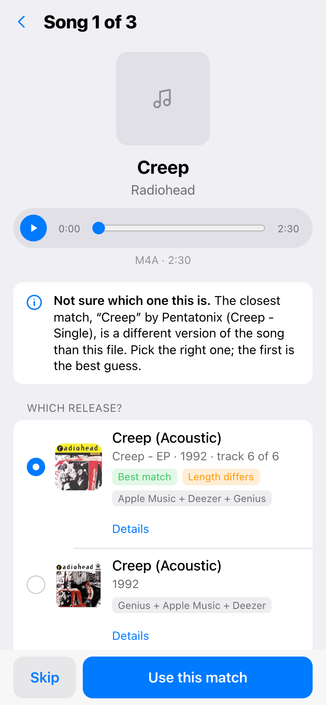
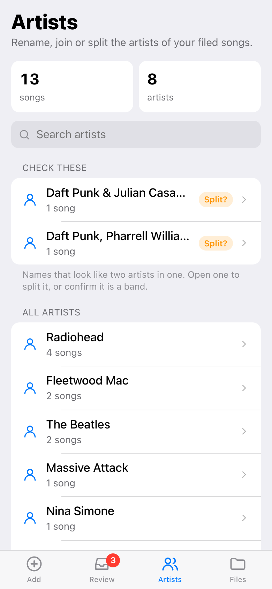
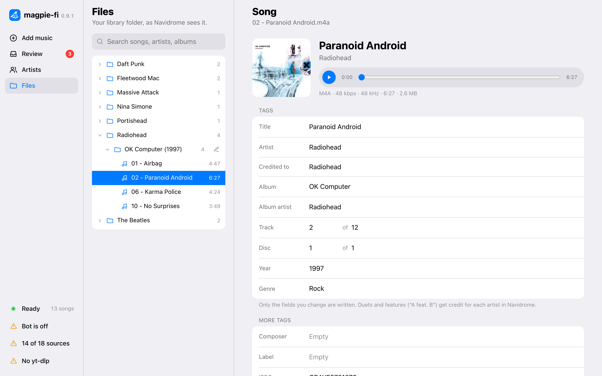

<div align="center">

# 🐦 magpie-fi

**Your own music service. Send a link, get a clean library.**

[](https://github.com/artamrj/magpie-fi/actions/workflows/magpie-fi.yml)
[](https://github.com/artamrj/magpie-fi/releases)
[](https://github.com/artamrj/magpie-fi/pkgs/container/magpie-fi)
[](LICENSE)



</div>

Send a Spotify, Apple Music, Deezer, YouTube or Shazam link to your Telegram bot, paste it in
the web page, or drop files into a folder. magpie-fi gets the songs, finds out what they are,
fixes their tags, cover, lyrics and loudness, and files them into a tidy library.
[Navidrome](https://www.navidrome.org) plays that library on every device. No subscription.

It is made for one household: you and a few guests.

## What it does

| | |
|---|---|
| **Three ways in** | A link (song, album or playlist), an audio file sent to the bot, or a file dropped into `inbox/`. All go through the same steps. |
| **Identifies every song** | By its sound (AcoustID, Shazam via SongRec) and its tags, with free sources: MusicBrainz, Apple Music, Deezer, Genius, Discogs, Last.fm, and the Persian catalogs Radio Javan, Navahang and Audiomack. |
| **Fixes the file** | Title, artists, album, track number, year, genre, ISRC, MusicBrainz IDs, a checked cover, synced lyrics (LRCLIB) and ReplayGain loudness. |
| **Files it once** | `Artist/Album (Year)/01 - Title.ext`. Duplicates are found by proof (same audio, ISRC or MusicBrainz ID), never by title alone. |
| **Asks when unsure** | A sure match is filed on its own. Everything else waits in **Review** until you pick. A wrong guess never enters the library silently. |
| **Keeps your files safe** | Nothing is overwritten. Originals go to a trash folder for 30 days. Lossy audio is never re-encoded. |
| **Playlists** | A playlist link also becomes an `.m3u8` playlist that Navidrome imports. |

## How it works



Spotify, Apple Music and Deezer links are read only for the song list. The audio comes from
YouTube. magpie-fi breaks no copy protection and uses no paid API.

## Screenshots

The web page is also a Telegram Mini App, so it works the same on a phone and on a desktop.

| Review list | One song, one question | Artists |
|:---:|:---:|:---:|
|  |  |  |

<div align="center">

<br><em>Files: your library as it is on disk, with editable tags and a player.</em>
</div>

| Page | What you do there |
|---|---|
| **Add music** | Paste a link and watch it arrive. Failed songs show the reason and a Retry. |
| **Review** | Pick the right release or cover, type the tags yourself, or remove the file. |
| **Artists** | Rename an artist, join two spellings, split a duet, merge an album shown twice. |
| **Files** | Browse and search the library, edit tags, listen. |

## Quick start

You need Docker and a running [Navidrome](https://www.navidrome.org/docs/installation/docker/).
The image runs on amd64 and arm64 (NAS, Raspberry Pi, VPS).

**1. Get the two files**

```bash
mkdir magpie-fi && cd magpie-fi
```

```bash
curl -fsSLO https://raw.githubusercontent.com/artamrj/magpie-fi/main/compose.yaml
```

```bash
curl -fsSL -o .env https://raw.githubusercontent.com/artamrj/magpie-fi/main/.env.example
```

**2. Edit `.env`**

Set at least these, then run `chmod 600 .env`:

| Setting | Meaning |
|---|---|
| `MUSIC_ROOT` | Folder for your music. magpie-fi creates `inbox/` and `library/` inside it. |
| `DATA_ROOT` | Folder for the database. Use a local disk, not a network share. |
| `PUID` / `PGID` | The user that owns the music files (run `id`). |
| `MAGPIE_ACOUSTID_KEY` | Strongly recommended. Free key from [acoustid.org](https://acoustid.org/new-application). |

**3. Start it**

```bash
docker compose pull && docker compose up -d --no-build
```

Open `http://<your-server>:7331`.

**4. Point Navidrome at the library**

Set Navidrome's music folder to `MUSIC_ROOT/library`. Recommended Navidrome settings: file
watcher on, playlists imported from `Playlists`, and `Scanner.PurgeMissing = "never"`.

That is all. Paste a link on the **Add music** page, or copy files into `MUSIC_ROOT/inbox`.

> [!WARNING]
> Without Telegram there is no login: anyone who can reach port 7331 can use the page. Keep it
> on your home network, or set up the bot below.

## Telegram bot (optional)

The bot lets you send links and files from your phone, asks you about unsure songs, and is the
login for the web page.

1. Create a bot with [@BotFather](https://t.me/BotFather) and put its token in
   `MAGPIE_TELEGRAM_BOT_TOKEN`.
2. Start magpie-fi, send `/id` to the bot, and put your number in `MAGPIE_TELEGRAM_OWNERS`.
   Restart.
3. For the Mini App inside Telegram, set `MAGPIE_PUBLIC_URL` to an HTTPS address of the page,
   for example from [Tailscale Funnel](https://tailscale.com/kb/1223/funnel).

| Command | What it does |
|---|---|
| `/queue` | What is on the way |
| `/health` | Is everything working |
| `/id` | Your Telegram ID |
| `/guests` | Invite people or remove them (owners) |
| `/web` | A one-time link to log in to the web page (owners) |

Owners can use the bot and the web page. Guests can only send links and files to the bot.
Telegram bots can receive files up to 20 MB.

## Settings

All settings live in `.env`. Every one is explained in [`.env.example`](.env.example). The most
used:

| Setting | Default | Meaning |
|---|---|---|
| `MAGPIE_PORT` | `7331` | Port of the web page |
| `MAGPIE_AUDIO_FORMAT` | `best` | Keep YouTube's own stream (Opus or AAC). `m4a` or `opus` force one format. |
| `MAGPIE_LYRICS` | `true` | Fetch lyrics from LRCLIB |
| `MAGPIE_TRASH_DAYS` | `30` | Days that originals stay in the trash |
| `MAGPIE_MAX_PARALLEL_DOWNLOADS` | `2` | Use `1` on a server that YouTube limits |
| `MAGPIE_LASTFM_KEY`, `MAGPIE_DISCOGS_TOKEN`, `MAGPIE_YOUTUBE_API_KEY` | off | Optional free keys for more sources |
| `MAGPIE_TAG` | `latest` | Pin a release, e.g. `0.9.1` |

If YouTube asks you to sign in, put a Netscape-format `cookies.txt` into `config/ytdlp/`.

## Where your music lives

```text
MUSIC_ROOT/
├── inbox/                     drop new music here
├── library/                   Navidrome's music folder
│   ├── Radiohead/
│   │   └── OK Computer (1997)/
│   │       ├── 01 - Airbag.flac
│   │       ├── 01 - Airbag.lrc
│   │       └── cover.jpg
│   └── Playlists/Anna - Road Trip.m3u8
└── .magpie-fi/trash/<date>/   originals, kept 30 days
```

Files that are already in `library/` are indexed, not moved or renamed. Back up `.env`,
`DATA_ROOT` and the library.

## Update

```bash
docker compose pull && docker compose up -d --no-build
```

Changes per version are in [CHANGELOG.md](CHANGELOG.md).

## For developers

One Rust program (axum, tokio, SQLite) serves a React + TypeScript page. The image also holds
ffmpeg, fpcalc, SongRec, rsgain, yt-dlp and Deno.

```bash
./scripts/dev.sh
```

This starts the backend on `:7331` and the page on `:5173` with live reload. It needs Rust,
Node.js, `cargo-watch` and ffmpeg. Local data goes to `.local/`.

```bash
cargo fmt --all -- --check && cargo clippy --all-targets --locked && cargo test --locked
```

```bash
cd web && npm ci && npm run format:check && npm run lint && npm run build
```

| Document | Content |
|---|---|
| [docs/BLUEPRINT.md](docs/BLUEPRINT.md) | What and why: principles, library layout, naming, tags, decisions |
| [docs/TECHNICAL-OVERVIEW.md](docs/TECHNICAL-OVERVIEW.md) | How: pipeline steps, scoring, API, tables, file map |
| [AGENTS.md](AGENTS.md) | Rules and commands for contributors and coding agents |
| [CONTRIBUTING.md](CONTRIBUTING.md) | How to report a problem or send a change |

## Support the project

If magpie-fi is useful to you, a ⭐ on GitHub helps other people find it. Problems and ideas
are welcome as [issues](https://github.com/artamrj/magpie-fi/issues/new/choose).

## History

magpie-fi replaces two older projects and joins them into one:
[ununknown](https://github.com/artamrj/ununknown) (fixing tags) and
[sync-me-maybe](https://github.com/artamrj/sync-me-maybe) (the Telegram download bot). Both
are no longer developed.

## License

[MIT](LICENSE)
